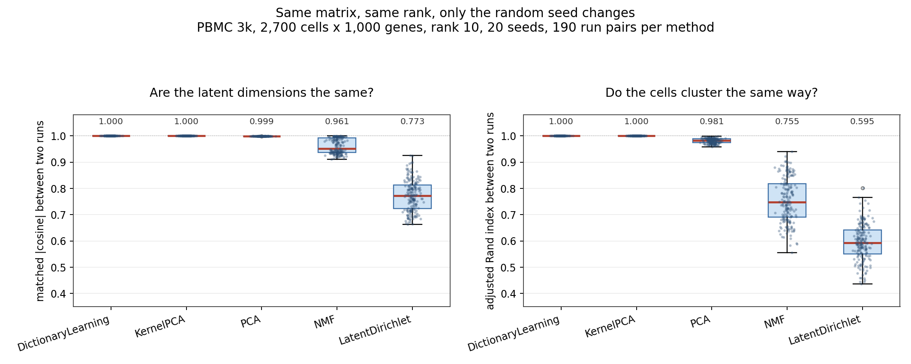
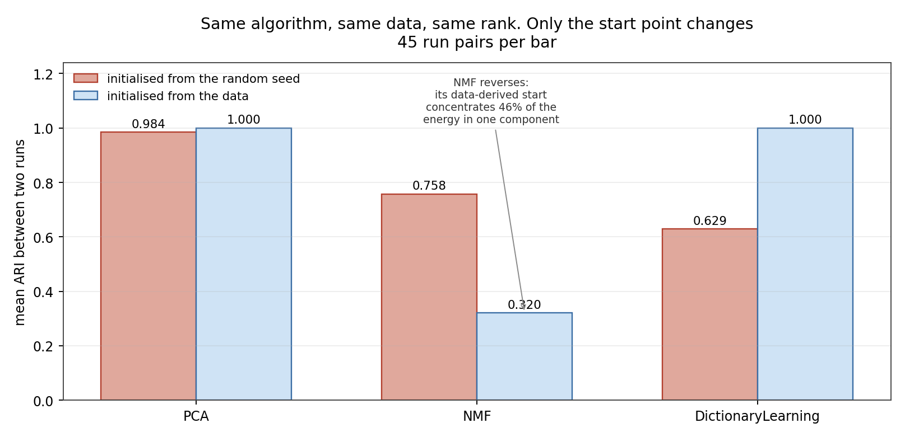

# Stability of matrix factorization on single cell gene expression

Run the same decomposition twice on the same matrix, changing nothing but the random seed.
Do you get the same answer?

For three of the five methods tested here the answer is yes, exactly, every time. That turns
out to say more about scikit-learn's default initialisation than about the algorithms. Force
a random start and the same algorithm that scored a perfect 1.0000 drops to 0.6288.



## Data

10x Genomics PBMC 3k, 2,700 human peripheral blood immune cells by 32,738 genes.

Preprocessing, in `src/01_prepare_data.py`:

1. keep cells with at least 200 detected genes, keep genes detected in at least 3 cells, which
   leaves 2,700 by 13,714
2. normalise each cell to 10,000 counts, then `log1p`
3. keep the 1,000 most variable genes

The result is 2,700 by 1,000, every entry non-negative, min 0.0 and max 7.47. Non-negativity
matters because NMF and LDA cannot run without it, and the point of the study is that all five
methods see the identical matrix.

## Design

Five decompositions at rank 10, twenty random seeds each, 190 run pairs per method.

| family | methods |
|---|---|
| factors the covariance structure | PCA, KernelPCA |
| factors the data matrix directly | NMF, DictionaryLearning, LatentDirichletAllocation |

## Metrics

Two, because they answer different questions.

**Matched cosine.** Are the ten latent dimensions themselves the same? Two runs return their
components in arbitrary order and arbitrary sign, so the comparison has to solve the pairing
first. Build the 10 by 10 matrix of `|cosine|` between every component of run A and every
component of run B, find the optimal one to one pairing with the Hungarian algorithm
(`scipy.optimize.linear_sum_assignment`), then average the matched values. 1.0 means the two
runs found the same subspace.

**Adjusted Rand index.** Does the choice of seed change what you would conclude? Cluster the
cells in each run's embedding with k-means at k=8, then measure agreement between the two
clusterings. ARI corrects for chance, so 0.0 is what you would get from unrelated partitions.

The second metric is the one that matters. A method can move its factors slightly and still
reorganise which cells land together, and it is the cell groupings that a biologist would
actually read off the analysis.

## Result 1, the five methods

| method | matched cosine | worst pair | ARI | worst pair | fit time, 20 runs |
|---|---|---|---|---|---|
| DictionaryLearning | 1.0000 | 1.0000 | 1.0000 | 1.0000 | 206.4 s |
| KernelPCA | 1.0000 | 1.0000 | 1.0000 | 1.0000 | 13.6 s |
| PCA | 0.9993 | 0.9982 | 0.9812 | 0.9585 | 1.7 s |
| NMF | 0.9610 | 0.9116 | 0.7554 | 0.5563 | 6.9 s |
| LatentDirichletAllocation | 0.7730 | 0.6628 | 0.5945 | 0.4367 | 295.9 s |

LDA is the least reproducible, not NMF. Two LDA runs on identical input agree on cell grouping
at ARI 0.59 on average and 0.44 in the worst pair, which means a meaningful share of the cells
change neighbours for no reason other than the seed.

The three perfect scores are not a property of those algorithms. Reading the scikit-learn
source explains all three:

- **KernelPCA** with `eigen_solver="auto"` picks the dense `eigh` path unless
  `n_components < 10`, and this study uses exactly 10, so `random_state` is never read.
- **DictionaryLearning** with `dict_init=None` starts from an exact `linalg.svd` of the data
  followed by `svd_flip`, so again the seed does nothing.
- **PCA** lands at 0.9993 rather than 1.0 because `auto` selects randomized SVD here, and that
  solver does use the seed.

## Result 2, where the instability actually lives

Same algorithm, same data, same rank. The only change is the start point.



| condition | matched cosine | ARI |
|---|---|---|
| PCA, randomized SVD | 0.9994 | 0.9843 |
| PCA, exact SVD | 1.0000 | 1.0000 |
| NMF, random init | 0.9608 | 0.7577 |
| NMF, NNDSVDa init | 0.9670 | 0.3202 |
| DictionaryLearning, random init | 0.8344 | 0.6288 |
| DictionaryLearning, SVD init | 1.0000 | 1.0000 |

DictionaryLearning is the clean case. Nothing about the algorithm changed, and reproducibility
went from perfect to an ARI of 0.6288, worst pair 0.5019.

NMF runs the other way, and that is the more interesting row. Its data derived start gives
slightly better agreement in factor space (0.9670 against 0.9608) and much worse agreement
downstream (0.3202 against 0.7577). `src/05_dl_init_fix.py` measures why. Under NNDSVDa the
solution is effectively lower rank than it claims: the top component holds 45.7 percent of the
embedding energy and the bottom four hold under 1 percent each, the last one 0.01 percent.
Clustering then rests on directions that are close to empty, so a small seed difference moves
cells across boundaries. Under random init the energy spreads from 17.7 percent down to 3.9
percent and no component is degenerate.

So factor stability and downstream stability are not the same measurement, and a method can
improve on one while getting worse on the other.

## What this does not show

- One dataset, one rank, one clustering algorithm at one k. Nothing here establishes that the
  ordering holds at rank 30, on a different tissue, or under Leiden clustering.
- Stability is not accuracy. A method that returns the identical wrong answer every time scores
  1.0000 here.
- LDA is being applied to log normalised values rather than raw counts, which is not what its
  generative model assumes. That is the standard practical usage, and it is a caveat, not a bug.

## Reproducing

```
pip install -r requirements.txt
python src/01_prepare_data.py     # downloads PBMC 3k and writes data/
python src/02_stability.py        # five methods, 20 seeds, writes results.json
python src/03_initialisation.py   # initialisation conditions
python src/05_dl_init_fix.py      # corrected DictionaryLearning conditions + NMF diagnostic
python src/04_figure.py           # both figures
```

About 12 minutes end to end. `src/02_stability.py` writes each method's result to
`partial_results.json` as soon as it finishes and skips completed methods on restart, because
holding all 100 embeddings at once was enough to get the first version killed for memory.

## Note on a bug in an earlier version of this study

The first version of `src/03_initialisation.py` tried to give DictionaryLearning a random
dictionary by passing `dict_init` alone. scikit-learn takes a caller supplied start only when
both `code_init` and `dict_init` are given, so it silently fell back to the exact SVD and both
conditions measured the same thing, reporting 1.0000 for a condition that should have been
unstable. `src/05_dl_init_fix.py` passes both and asserts the two random starts actually differ
before fitting. The 0.8344 and 0.6288 figures above come from the corrected run.
